<!-- Theme-sensitive animated banner -->
<picture>
  <source media="(prefers-color-scheme: dark)" srcset="readmefile/dark.svg">
  <source media="(prefers-color-scheme: light)" srcset="readmefile/light.svg">
  
</picture>

<p align="center">
  <a href="https://www.linkedin.com/in/zouaghiwadii/"></a>
  <a href="mailto:zouaghi.wadii69@gmail.com"></a>

  <a href="https://profile.hackthebox.com/profile/01a0f913-281c-72a9-8c7f-9dc60747923d"></a>
  <a href="https://tryhackme.com/p/t0x1c2r00t"></a>
  <a href="https://ctftime.org/user/72627"></a>
</p>

---

## 👾 `$ whoami`

```bash
$ cat wadii.txt
Name       : Wadii Zouaghi
Role       : Cybersecurity student | CTF player | Full-stack developer
Focus      : Intrusion detection, DevSecOps, cloud security, threat intelligence
Plays      : Capture The Flag (web, crypto, forensics, stego, reverse)
Builds     : Security tools, MCP servers, web apps, games (Lanterns Studio)
Mindset    : Break it to understand it, then build it safer
Contact    : zouaghi.wadii69@gmail.com
```

I like understanding how systems get attacked so I can build and defend them better. I learn by doing: CTFs for the offensive side, labs for the defensive side, and projects to tie it all together.

> 💡 *"Security is not a product, but a process."* — Bruce Schneier

---

## 🚩 CTF Player

I play Capture The Flag competitions to sharpen my offensive skills. I enjoy chaining small clues into a flag, and I use CTFs to practice the same attack paths I later learn to detect and defend against in my security labs.

| Category | What I do | Typical tools |
|---|---|---|
| 🌐 **Web** | Injection, auth bypass, broken access control | Burp Suite, ffuf, browser DevTools |
| 🔑 **Crypto** | Classic ciphers, encoding chains, weak RSA | CyberChef, Python |
| 🔍 **Forensics** | Packet captures, file and log analysis | Wireshark, strings, exiftool |
| 🖼️ **Steganography** | Hidden data in images and files | steghide, zsteg, my own [Steganography-Python](https://github.com/WadiiZouaghi/Steganography-Python) |
| ⚙️ **Reverse engineering** | Reading binaries and logic | Ghidra, gdb |
| 🕵️ **OSINT** | Tracing clues from public data | Search operators, metadata |

```text
 recon  ──▶  enumerate  ──▶  exploit  ──▶  flag{...}  ──▶  write-up
```

---

## 🛡️ What I Can Do

| Area | What I work with |
|---|---|
| 🕵️ **Intrusion detection** | Suricata, Zeek, Splunk, Grafana, Kali Linux attack simulations |
| 🐳 **DevSecOps** | Docker, containerized apps, CI/CD pipelines |
| ☁️ **Cloud security** | AWS architecture and secure cloud design |
| 📋 **Audit & governance** | ISO 27001 audits, ISO 22301 continuity planning (BIA) |
| 🧠 **Threat intelligence** | CTI, MCP-based threat-intel tooling |
| 📡 **Mobile network security** | 3G / 4G / 5G authentication (AKA) |
| 💻 **Full-stack development** | Symfony, JavaScript, Python web apps and tools |

> ⚠️ All security work is done in CTF platforms, isolated labs or authorized environments.

---

## 🛠️ Tech Stack

**Languages & Web**  


**Security & Monitoring**  


**DevOps, Cloud & Tools**  


---

## 📂 Featured Projects

| Project | Description | Stack |
|---|---|---|
| [**HANA-MCP**](https://github.com/WadiiZouaghi/HANA-MCP) | Full-stack SAP HANA monitoring app built around MCP | JavaScript |
| [**Steganography-Python**](https://github.com/WadiiZouaghi/Steganography-Python) | Hide and extract data inside files, a classic CTF category | Python |
| [**GameHub**](https://github.com/WadiiZouaghi/GameHub) | Symfony-based gaming platform to manage and discover games and join community events | Symfony, Twig |

---

## 📈 GitHub Stats

<p align="center">
  <picture>
    <source media="(prefers-color-scheme: dark)" srcset="https://activity-graph.vercel.app/graph?username=WadiiZouaghi&bg_color=030712&color=94A3B8&line=00FF9C&point=34D399&area_color=0D9488&area=true&hide_border=true&radius=12">
    <source media="(prefers-color-scheme: light)" srcset="https://activity-graph.vercel.app/graph?username=WadiiZouaghi&bg_color=FFFFFF&color=475569&line=0D9488&point=10B981&area_color=E6FFFA&area=true&hide_border=true&radius=12">
    
  </picture>
</p>

<p align="center">
  <picture>
    <source media="(prefers-color-scheme: dark)" srcset="https://ghstats.dev/api/card?username=WadiiZouaghi&bg=030712&title_color=00FF9C&text=94A3B8&icon_color=34D399&border_color=0D9488">
    <source media="(prefers-color-scheme: light)" srcset="https://ghstats.dev/api/card?username=WadiiZouaghi&bg=FFFFFF&title_color=0D9488&text=475569&icon_color=10B981&border_color=E2E8F0">
    
  </picture>
  <picture>
    <source media="(prefers-color-scheme: dark)" srcset="https://ghstats.dev/api/langs?username=WadiiZouaghi&layout=grid&bg=030712&title_color=00FF9C&text=94A3B8&icon_color=34D399&border_color=0D9488">
    <source media="(prefers-color-scheme: light)" srcset="https://ghstats.dev/api/langs?username=WadiiZouaghi&layout=grid&bg=FFFFFF&title_color=0D9488&text=475569&icon_color=10B981&border_color=E2E8F0">
    
  </picture>
</p>

---

<p align="center">
  <b>Want to team up for a CTF or collaborate on a security tool? Reach out!</b><br/>
  <sub>Learning to break things so I can build them safer.</sub>
</p>


